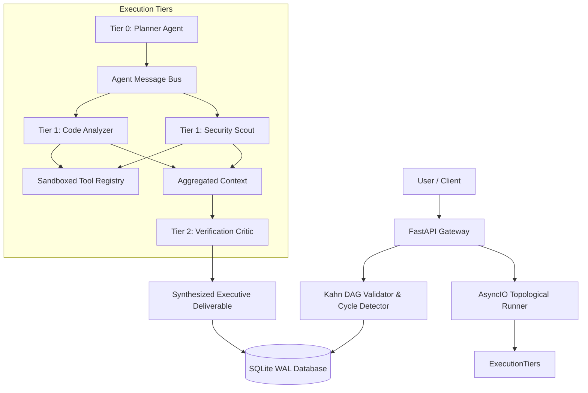

# AgentFlow — Multi-Agent Workflow Orchestration Platform

**Author:** Alvin MS ([@Soulofghost](https://github.com/Soulofghost))  
**Domain:** Artificial Intelligence & Distributed Agent Systems  
**Tier:** ⭐ Flagship Portfolio Project  
**Status:** Verified & Production-Ready  

---

## 1. Project Introduction

**AgentFlow** is an autonomous multi-agent workflow orchestration platform that coordinates specialized artificial intelligence agents along Directed Acyclic Graph (DAG) topologies. Built around an asynchronous topological execution engine, AgentFlow handles dependency resolution, cycle detection, stateful message bus routing, and sandboxed tool dispatching across distinct agent personas (Planners, Researchers, Code Analysts, and Verification Critics).

---

## 2. Problem Statement

Deploying multi-agent AI systems in production presents key engineering hurdles:
- **Uncontrolled Loops & Deadlocks:** Unstructured agent chats often enter circular infinite debates without reaching consensus.
- **Missing Dependency Resolution:** Agents require strict prerequisite sequencing (e.g. static analysis must finish before the verification critic reviews code).
- **Unsandboxed Tool Execution:** Blindly granting autonomous agents shell access introduces remote code execution hazards.
- **Opaque Reasoning Traces:** Black-box orchestration leaves operators without granular step-level audit logs.

---

## 3. Proposed Solution

AgentFlow solves these coordination challenges with formal graph execution semantics:
- **Topological Sorting with Cycle Detection:** Kahn’s algorithm evaluates node dependencies into parallelizable execution tiers, rejecting cyclical graphs before execution begins.
- **Stateful Dependency Context Passing:** Downstream agents receive verified outputs of their specific parent nodes rather than an unconstrained chat dump.
- **Sandboxed Tool Registry:** Specialized tools (`math_calculator`, `search_mock`, `schema_validator`, `code_linter`) run within strict security boundaries.
- **Full Execution Telemetry:** Every step record includes duration, token payloads, tool outputs, and synthesis artifacts persisted in an ACID SQLite database.

---

## 4. Key Features

- **Topological DAG Runner:** Automatically resolves dependency trees and executes independent branches concurrently via Python AsyncIO.
- **Cycle Prevention:** Rigorous graph validation checks node IDs and detects cycles before storing or executing workflows.
- **Persona Role Specialization:** Supports structured personas (Architect Planner, Security Scout, Code Linter, Verification Critic).
- **Interactive SVG DAG Visualizer:** Visualizes node topologies, directed flow vectors, and live execution status states (`pending`, `running`, `succeeded`, `failed`).
- **Pre-configured Production Templates:** Includes ready-to-deploy DAG templates for automated code audits and fact-verified research synthesis.

---

## 5. Architecture Diagram



---

## 6. Technology Stack

- **Backend:** Python 3.12+, FastAPI, Uvicorn, Pydantic v2
- **Orchestration Engine:** Asynchronous Topological Sorter (Kahn's Algorithm), AsyncIO Concurrency
- **Persistence:** SQLite 3 (WAL mode)
- **Frontend:** HTML5, CSS Custom Properties, Vanilla JavaScript, SVG Vector Canvas
- **Testing:** Pytest, HTTPX TestClient
- **Containerization & CI:** Docker, Docker Compose, GitHub Actions

---

## 7. Folder Structure

```
agentflow/
├── backend/
│   ├── app/
│   │   ├── engine/
│   │   │   ├── dag.py            # Topological sort & cycle detection
│   │   │   ├── tools.py          # Sandboxed tool registry (math, linter, search)
│   │   │   └── runner.py         # Asynchronous tiered DAG execution runner
│   │   ├── routers/
│   │   │   ├── workflows.py      # Workflow DAG template CRUD
│   │   │   └── executions.py     # Execution trigger and telemetry stream
│   │   ├── config.py             # Environment configuration
│   │   ├── database.py           # Database connection & seed workflows
│   │   ├── main.py               # Application entrypoint & static mount
│   │   └── schemas.py            # Pydantic request & response schemas
│   ├── requirements.txt          # Python dependencies
│   └── tests/
│       ├── test_dag.py           # Graph cycle detection & sorting unit tests
│       ├── test_tools.py         # Sandboxed tool execution tests
│       └── test_api.py           # End-to-end API integration tests
├── frontend/
│   ├── index.html                # Industrial command matrix layout
│   ├── style.css                 # Cybernetics theme & SVG canvas styling
│   └── app.js                    # DAG renderer, polling loop & modal controller
├── .github/workflows/ci.yml      # Automated GitHub Actions test workflow
├── .env.example                  # Environment configuration defaults
├── .gitignore                    # Python & database ignore rules
├── Dockerfile                    # Container build file
├── docker-compose.yml            # Multi-service composition
├── LICENSE                       # SPDX MIT declaration
└── README.md                     # Comprehensive technical documentation
```

---

## 8. Installation Instructions

### Prerequisites
- Python 3.10+ (or `uv` runner)
- Git

### Setup Steps
```bash
# Clone the repository
git clone https://github.com/Soulofghost/agentflow.git
cd agentflow

# Create virtual environment
python -m venv venv
source venv/bin/activate  # Windows: .\venv\Scripts\activate

# Install dependencies
pip install -r backend/requirements.txt

# Run server
uvicorn backend.app.main:app --host 127.0.0.1 --port 8003 --reload
```
Navigate to `http://127.0.0.1:8003` to access the orchestration console.

---

## 9. Environment Configuration

Copy `.env.example` to `.env`:
```ini
PORT=8003
ENVIRONMENT=development
DB_PATH=backend/data/agentflow.db
LOG_LEVEL=info
```

---

## 10. Database Setup

Database initialization is automatic via `init_db()` in `database.py`. It initializes `workflows`, `executions`, and `agent_logs` tables and seeds default templates upon first boot.

---

## 11. API Documentation

| Method | Endpoint | Description |
|---|---|---|
| `GET` | `/api/v1/health` | Engine health status and concurrency mode |
| `GET` | `/api/v1/workflows` | List all available DAG workflow templates |
| `POST` | `/api/v1/workflows` | Define custom workflow; validates DAG for cycles before saving |
| `GET` | `/api/v1/workflows/{id}` | Fetch workflow definition and node dependency specifications |
| `POST` | `/api/v1/executions` | Trigger asynchronous execution run along workflow DAG |
| `GET` | `/api/v1/executions/{id}` | Fetch real-time execution progress, step logs, and outputs |
| `GET` | `/api/v1/executions` | List recent execution history |

Interactive API documentation is accessible at `/docs`.

---

## 12. UI Walkthrough

The interface provides an industrial flow matrix:
1. **Templates & Dispatch (Left):** Select pre-built DAGs, input task objectives, and launch multi-agent runs.
2. **Interactive DAG Canvas (Center):** Visualizes node roles, dependency paths, and execution status rings in real time.
3. **Dialogue Stream & Deliverables (Right):** Monitors agent reasoning traces, tool execution parameters, and copies the final synthesized deliverable.

---

## 13. Testing Instructions

AgentFlow includes comprehensive unit and integration test coverage:

```bash
pytest backend/tests/ -v
```

---

## 14. Security Considerations

- **Cycle Rejection:** Cyclical graphs are rejected at the schema validation boundary to prevent infinite execution loops.
- **Sandboxed Tool Execution:** Tools operate on constrained inputs using AST parsing without unrestricted shell invocation.
- **SQL Sanitization:** Parameterized queries isolate persistence transactions from injection attacks.

---

## 15. Deployment Instructions

### Docker Deployment
```bash
docker compose up -d --build
```
Access the application at `http://localhost:8003`.

---

## 16. Known Limitations

- Concurrency is managed via Python AsyncIO on a single host. Distributed node execution across multiple servers requires an external message broker (e.g. RabbitMQ or Redis).
- Tool outputs are currently formatted as JSON text streams.

---

## 17. Future Roadmap

- [ ] Distributed Celery / Redis task queue integration.
- [ ] Human-in-the-loop interactive approval checkpoints.
- [ ] Export DAG definitions to LangGraph and Airflow formats.

---

## 18. License

Distributed under the MIT License. See `LICENSE` for details.
